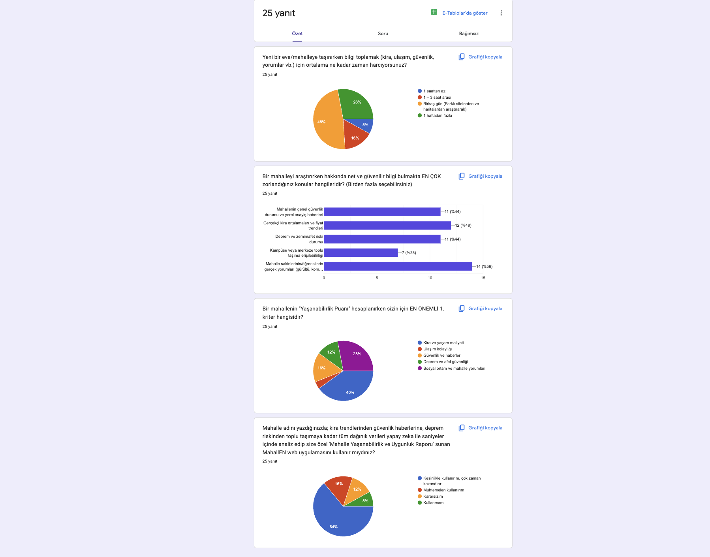

# MahallEN Student Validation Survey Analysis

- **Project:** MahallEN — Axiom Digital
- **Related issue:** [#8 — Analyze survey results & weights](https://github.com/axiom-digital/mahallEN/issues/8)
- **Prepared:** 28 October 2026
- **Evidence:** [Google Forms results screenshot](survey-results.png), supplied on 20 October 2026
- **Responses shown:** 25 for each of the four questions
- **Status:** Reviewed by Osman Kalkan. The team has selected the initial scoring weights recorded below; application integration remains a separate task.

## Purpose and main findings

The survey explores how much effort neighborhood research takes, which information is difficult to find, which criterion respondents prioritize, and whether they would use the proposed MahallEN application. Its results inform initial product priorities and the team’s selected scoring configuration.

Of the 25 responses, 19 (76%) indicate that neighborhood research takes several days or more. Resident/student comments are the most frequently selected information gap (56%), followed by realistic rent information and trends (48%). Cost is the most-selected first-priority criterion (40%), followed by social environment and neighborhood comments (28%). Twenty responses (80%) express definite or probable intention to use the proposed application.

These findings support further development and testing of the concept. They do not establish the accuracy of neighborhood data, actual time savings, or satisfaction with a working product.

## 1. Time spent researching a neighborhood

**Question, translated from Turkish:** On average, how much time do you spend collecting information such as rent, transportation, safety and comments when moving to a new home or neighborhood?

| Response option | Responses | Percentage |
| --- | ---: | ---: |
| Less than 1 hour | 2 | 8% |
| Between 1 and 3 hours | 4 | 16% |
| Several days, researching different websites and maps | 12 | 48% |
| More than 1 week | 7 | 28% |
| **Total** | **25** | **100%** |

**Interpretation:** The largest group reports spending several days. Combining this group with those reporting more than one week gives 19/25 responses (76%). This supports the problem statement that neighborhood research can require substantial effort across different sources.

The answer bands do not support an exact average number of hours. The survey also does not measure how much time MahallEN actually saves.

## 2. Information that is hardest to find

**Question, translated from Turkish:** Which topics are the most difficult to find clear and reliable information about when researching a neighborhood? More than one option may be selected.

| Information category | Responses selecting it | Percentage of 25 responses |
| --- | ---: | ---: |
| Actual comments from residents/students | 14 | 56% |
| Realistic average rents and price trends | 12 | 48% |
| General neighborhood safety and local incident news | 11 | 44% |
| Earthquake, ground and disaster-risk context | 11 | 44% |
| Public transportation access to campus or the city center | 7 | 28% |

**Interpretation:** Comments and rent transparency are the most frequently selected information gaps. Safety/news and disaster information are also selected by a substantial share of responses. Transport is selected less often, but the results do not justify removing it from the agreed MVP scope.

This is a multiple-selection question: the percentages intentionally sum to more than 100%. They describe information gaps and are not used directly as scoring weights. The screenshot truncates the parenthetical examples in the resident/student-comments option; the table preserves its visible main meaning without reconstructing the missing text.

## 3. Most important criterion for a livability score

**Question, translated from Turkish:** What is your single most important criterion when calculating a neighborhood's livability score?

| First-priority criterion | Responses | Percentage |
| --- | ---: | ---: |
| Rent and cost of living | 10 | 40% |
| Social environment and neighborhood comments | 7 | 28% |
| Safety and news | 4 | 16% |
| Earthquake and disaster safety | 3 | 12% |
| Ease of transportation | 1* | 4%* |
| **Total** | **25** | **100%** |

\* The transportation slice has no visible percentage label in the screenshot. Its 4% share is inferred from the remaining percentage after the four labeled slices, together with the chart legend: 100 − 40 − 28 − 16 − 12 = 4%. With 25 responses, this corresponds to one response. Confirm this entry against the Google Forms export during review.

**Interpretation:** Cost is the leading first priority, followed by social/community context. This differs from assuming that safety must receive the largest weight. The question records only each respondent's first choice; it does not measure a complete ranking or the precise strength of their preferences.

## 4. Intention to use MahallEN

**Question summary, translated from Turkish:** Would you use a MahallEN web application that combines scattered information about rents, safety news, earthquake risk and transportation into an AI-generated neighborhood livability and suitability report?

| Response option | Responses | Percentage |
| --- | ---: | ---: |
| Definitely would use it; it would save considerable time | 16 | 64% |
| Probably would use it | 4 | 16% |
| Undecided | 3 | 12% |
| Would not use it | 2 | 8% |
| **Total** | **25** | **100%** |

**Interpretation:** Positive stated intention is (16 + 4) / 25 = 80%. The remaining 20% are undecided or would not use the application. This supports continuing with a focused prototype and user testing.

Respondents evaluated a described concept, not a tested product. Therefore, 80% must not be reported as actual adoption, product satisfaction, or achievement of the M1 target that at least 70% of later users find the report useful/understandable. That target needs a separate test of a working increment.

## 5. Team decision on initial scoring weights

The team selected the following weights after reviewing the survey's first-priority results, the reported information gaps and the coverage needed for the MahallEN MVP. The configuration combines the survey findings with team judgment about a balanced neighborhood report.

| Component | Survey first-priority share | Team-selected weight | Rationale |
| --- | ---: | ---: | --- |
| Cost affordability | 40% | **32%** | Keep cost as the largest component while allowing the other dimensions sufficient influence. |
| Social/community context | 28% | **28%** | Retain its strong preference share and the leading information gap: comments were selected as difficult to find by 56%. |
| Safety/news context | 16% | **20%** | Give safety additional influence, considering that 44% reported difficulty finding reliable safety/news information. |
| Disaster context | 12% | **10%** | Retain a distinct contribution for disaster information within the overall balance of the report. |
| Transportation accessibility | 4%* | **10%** | Preserve meaningful transport coverage; 28% identified it as an information gap, while the first-choice question captures only one priority per response. |
| **Total** | **100%** | **100%** | |

The selected percentages are a team design decision informed by these findings. They are not a direct transcription of the vote shares or a statistically validated scoring model. The inferred transportation survey share retains the qualification in Section 3.

The selected overall livability formula is:

```text
L = 0.32 × C + 0.28 × M + 0.20 × S + 0.10 × D + 0.10 × T
```

C = cost affordability; M = social/community context; S = safety/news context; D = disaster context; T = transportation accessibility. Each component requires a documented 0–100 normalization, with higher values consistently meaning more favorable conditions. Missing required inputs should remain unavailable, with the complete aggregate withheld. The survey does not provide factual neighborhood values or separate family/professional preference weights.

This decision still needs to be implemented and tested. The code reviewed at commit [830c909](https://github.com/axiom-digital/mahallEN/commit/830c909eba97e7f2a6876e88d62a2c3ca8101173) uses four equal 25% weights and has no independent numeric community component. Keep the revised weights configurable and document how the community input is calculated.

## 6. Implications for existing work

| Existing work | Next action |
| --- | --- |
| #8 — Survey analysis | Keep this analysis and the team weighting decision linked to the issue. |
| #7 — Dataset | Provide traceable data and sources for the selected components, including community context. |
| #9 and #10 — Report generation and UI | Use and explain the agreed weights consistently in report content and score displays. |
| #24 — Verification | Check the implemented formula and record test results separately from this survey analysis. |

## 7. Limitations

- The 25-response summary supports initial decisions; the screenshot does not establish a representative sample or individual-response validation.
- First-choice votes are not a full preference ranking. The transportation share is inferred from the chart; the selected weights also include team judgment.
- The 80% result measures stated usage intention. Actual usefulness, accuracy, performance and time savings require testing with a working product.

## 8. Review and decision record

- **Reviewer:** Osman Kalkan
- **Review date:** 28 October 2026
- **Team decision:** Adopt initial weights of 32% cost, 28% social/community, 20% safety/news, 10% disaster and 10% transport.
- **Basis:** Review of the survey's priority votes and information gaps, combined with the team's assessment of MVP category coverage.
- **Follow-up:** Implement and test the selected formula, then link the resulting change and verification evidence to the existing issues.

## Evidence screenshot


